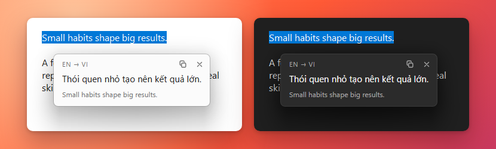
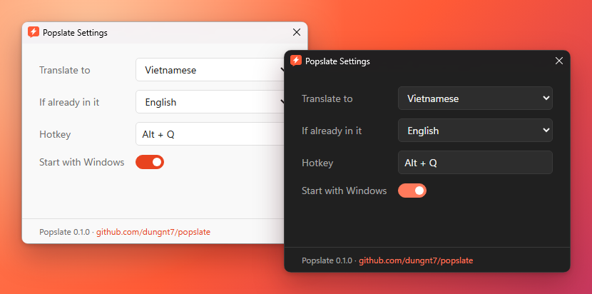

  

<h1 align="center">Popslate</h1>

Select text anywhere, press <kbd>Alt</kbd>+<kbd>Q</kbd>, read the translation.

Popslate is a small Windows app that translates text from any program (a browser, a PDF reader, Word, a chat window, a code editor) with Google Translate. It waits in the system tray until you need it. Most of its life is spent waiting, which it does very well.

It is built around 4 goals:

- **Simple.** One job, one shortcut. No accounts, no API keys, no features you have to learn first.
- **Easy to Use.** Select, press the shortcut, read. The translation opens right next to your mouse.
- **Fast.** The translation is usually on screen about 0.15 seconds after you press the keys.
- **Stable.** It works the same way every time. When it borrows your clipboard, it puts your things back. Not every guest does that.

## Install

1. Download `Popslate_<version>_x64-setup.exe` from the [Releases page](https://github.com/dungnt7/popslate/releases).
2. Run it. You don't need administrator rights.
3. Popslate starts and puts its icon in the system tray, next to the clock. If you don't see it, click the small **^** arrow there; Windows hides new tray icons at first. Drag the icon onto the taskbar to keep it in sight.

Popslate needs Windows 10 or 11 (64-bit) and an internet connection.

## How to Use

### Translate

1. **Select some text** in any program, the same way you would before copying it.
2. **Press <kbd>Alt</kbd>+<kbd>Q</kbd>.**
3. **Read the translation** in the small window next to your mouse. The original text is shown below it in grey.

In the popup you can:

- **Copy** the translation with the copy button at the top right.
- **Move** the popup by dragging its top bar.
- **Close** it with <kbd>Esc</kbd>, the **✕** button, or a click anywhere else.

If the text is already in your language (for example, Vietnamese text when you translate to Vietnamese), Popslate translates it to English instead. Translating Vietnamese into Vietnamese is accurate, but not very useful.

### Change Settings

Click the Popslate icon in the system tray and choose **Settings**.

- **Translate to:** the language you want to read.
- **If already in it:** the language to use when the text is already in your "Translate to" language.
- **Hotkey:** click the box, then press a new key combination. It must include <kbd>Ctrl</kbd>, <kbd>Alt</kbd>, <kbd>Shift</kbd> or <kbd>Win</kbd>. Press <kbd>Esc</kbd> to cancel.
- **Start with Windows:** turn it on to have Popslate ready every time you sign in.

Changes are saved right away. Popslate follows the Windows light or dark theme on its own.

### If Nothing Happens

- **Is any text selected?** With nothing selected, Popslate does nothing, on purpose. It once showed a message about it. That turned out to be one more window to close.
- **Is the shortcut used by another app?** If so, the Settings window opens by itself when Popslate starts and tells you. Pick another shortcut there.
- **Is the other program running as administrator?** Windows does not let normal apps read from administrator windows. This is a security feature, so we won't argue with it. Run that program normally, or copy the text somewhere else first.
- **Is it a terminal window?** In a terminal, <kbd>Ctrl</kbd>+<kbd>C</kbd> means "stop", not "copy". Popslate never presses it there. If the terminal doesn't share its selection, nothing happens.

### Privacy

The text you translate is sent to Google Translate. Nothing else is sent anywhere. Popslate keeps no history. To read the selection in some programs it uses the clipboard for a moment, then puts back what you had there.

### Uninstall

Open Windows **Settings → Apps → Installed apps**, find **Popslate**, and choose **Uninstall**. Tick "Delete the application data" to remove your settings too.

## macOS and Linux

Popslate is built on Tauri, which also runs on macOS and Linux, and the Windows-only parts of the code sit in a few clearly marked places. The app is close to ready for other systems. Its author is not.

## For Developers

How to build, test and release Popslate, and how it works inside: see [DEVELOPMENT.md](DEVELOPMENT.md).

## License

[MIT](LICENSE)
